常用数据集：MSCOCO

写在前面：

- object detection 定义：
  - identify the position and boundaries
  - classify the objects into different categories
- object detection 分类：
  - one-stage methods：推理快（**YOLO**, SSD, RetinaNet）
  - two-stage methods：识别准确率高（Faster R-CNN, Mask R-CNN, Cascade R-CNN）

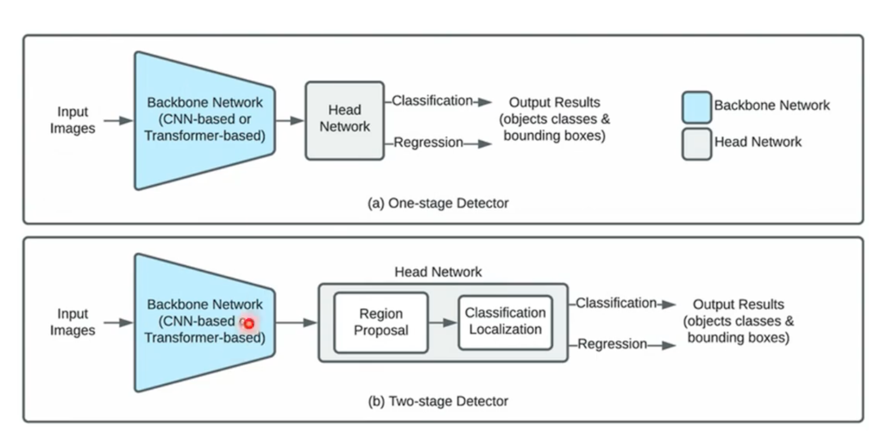

- bounding boxes
  - 常用指标：$IoU$（交集与并集的比值）
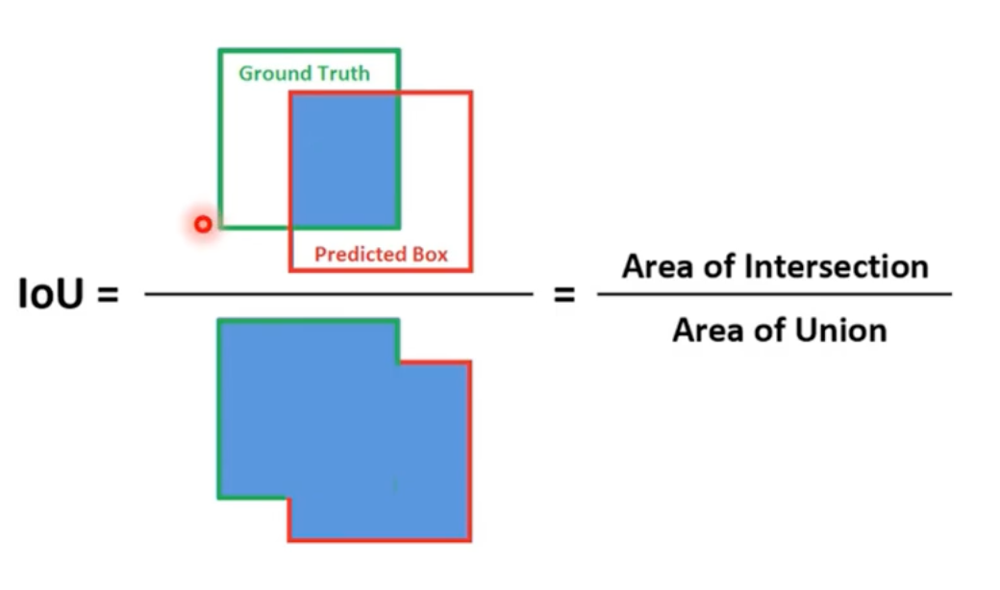
# v1
> You Only Look Once，速度快，适合实时检测；对小物体或相互靠近的物体准确率低（因为 grid system）

## 模型结构
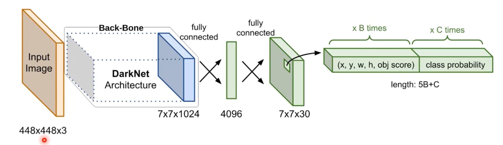
- backbone：普通的卷积网络
- 7x7x30 的 output：训练阶段用它和 input image 算 loss，推理阶段从它得到 bounding box 和 class probabilities
- input image:
  - objectness: 包含物体为1（注：如果不含物体为0，且xywh不被关心；**如果多个物体中心落在一个点，yolo-v1无法处理，因为只会给一个点分配一个标签**）
  - x, y: 中心点在 grid cell 中的相对位置（按百分比）
  - w, h: 所在 bounding box 相对 full image 的大小（按百分比）
  - class probabilities: 每个具体种类的概率
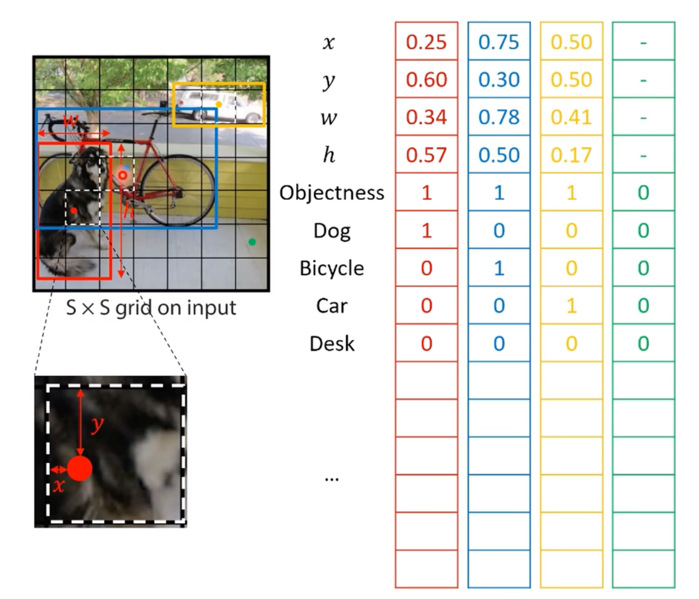

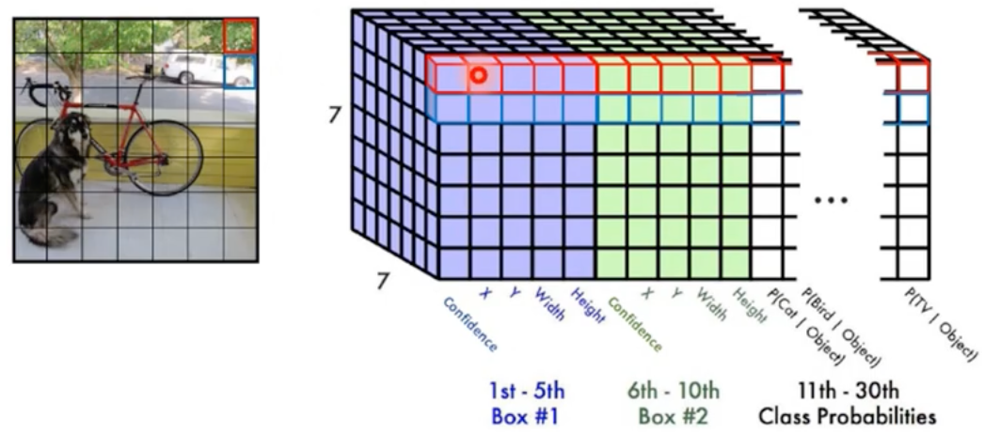
每一个 grid cell 预测出两个 bounding box （紫色和绿色），每个 bounding box 包含 cofidence 和xywh，$\text{confidence\ score}=Pr(Object)\times IoU, Pr=0或1$，白色方格表示 class probabilies，即$Pr(Class_i | Object)$
- 注：两个 bounding boxes 是 yolo-v1规定的，class probabilities 由两个 bounding boxes 共享
- 输出张量维度：$S\times S\times (5\times B+C)=7\times 7\times (5\times2+20)=1470$

## 训练阶段
1. 将 input image 分为 S x S 的 grid
2. 中心点决定用哪个 grid cell 预测 bounding box
3. 每个 grid cell 预测两个 bounding box 并计算 IoU，留高的删低的
4. 不包含中心点的 grid cell 参与计算 confidence loss 但不计算 localization or classification loss

### 损失函数
$1^{obj}$表示是选中的 IoU 大的 bounding box 就是1，反之是0

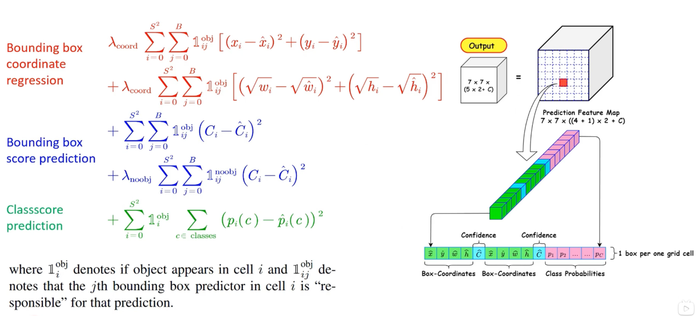

## 推理阶段
计算 $Pr(Class_i | Object)\times Pr(Object) \times IoU=Pr(Class_i)\times IoU$，后面两项其实就是 confidence score，整体作为 class-specific confidence score

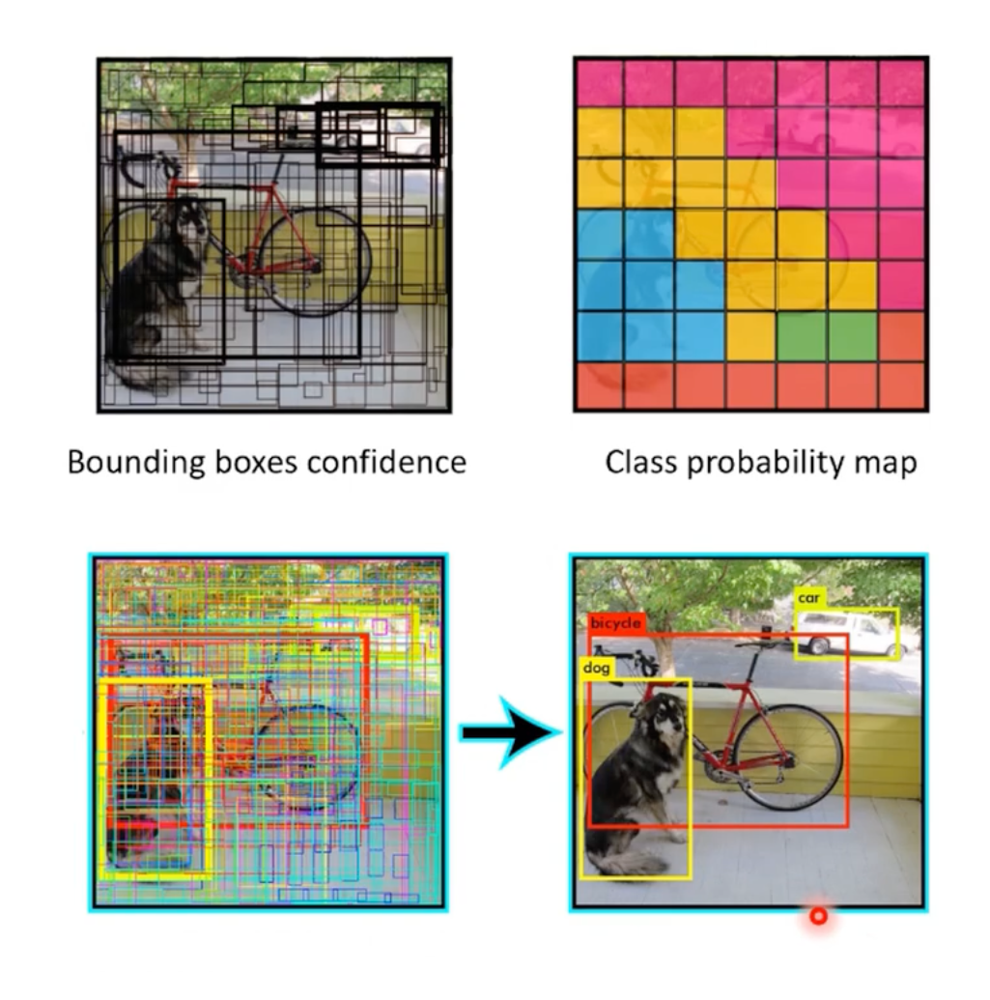

## NMS（Non-Maximum Suppression）

目的：从左下角的图的很多 bounding boxes 中找到右下角需要的三个 bounding box

按照 class-specific confidence score 排序，低于 thresh1 的归零

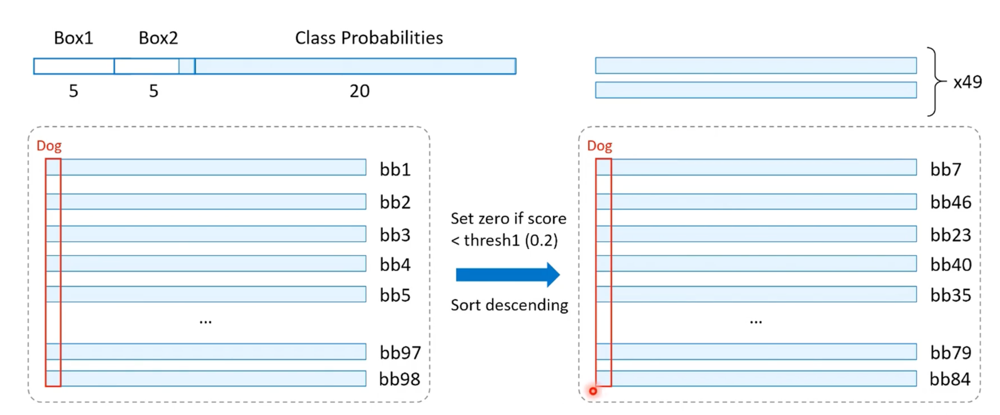

但看dog这一类，依次与最大值计算IoU，高于 thresh2 会认为在框同一个狗所以把小的归零，低于阈值保留。比完最大的将第二大设置为最大，循环。
之后依次计算 bicycle 等。得到稀疏矩阵。
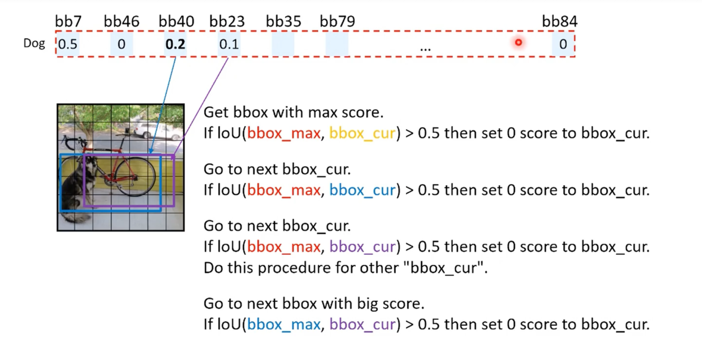

选择不全为 0 的 bounding box 画在输出图，选score最大的 class 作为标签。这也导致了一个框只能包含一个物体
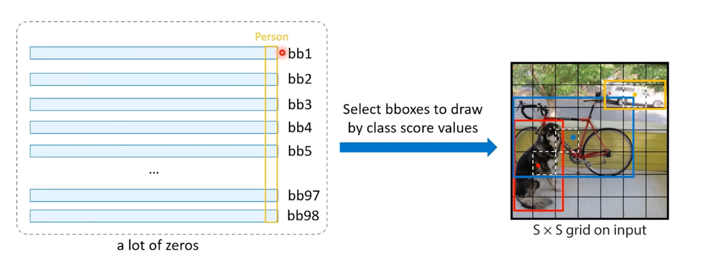

# v2
> 解决v1速度尚可但准确率和召回率较低的问题。

## Darknet-19
感受野（receptive field）：特征图上某点看到的输入图像的区域

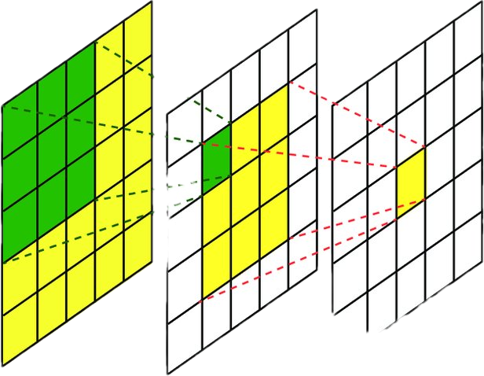

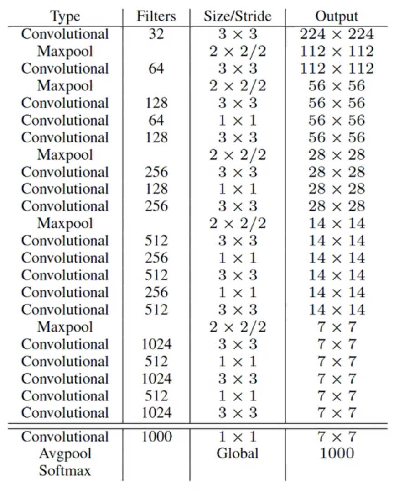
- $3\times 3$ Filters：2个3x3卷积核感受野相当于一个5x5，3个相当于7x7，提取 spatial features
- $1\times 1$ Filters：降低 dimensions 从而降低计算量
- 优点：降低参数量提高效率；获得足够 receptive field
- batch normalization：每个卷积层后面都有，加速收敛防止梯度消失或爆炸，提升模型稳定性
- global average pooling：最后阶段，把输出的每一个通道取平均然后用 softmax 分类

### batch normalization
1. 缓解内部协变量偏移（internal covariate shift）：训练时后面的layer会随前面的layer变化，丢失已学习特征，导致梯度爆炸或梯度消失，对 lr 等超参要求高，限制非线性激活函数的使用（**这个是初始目标，后续有论文说 batch normalization 能优化训练与ics无关，而是为训练空间引入平滑约束，减少训练波动**）
2. 使每个 batch 均值为0方差为1，为了保留更多特征引入两个可学习参数

    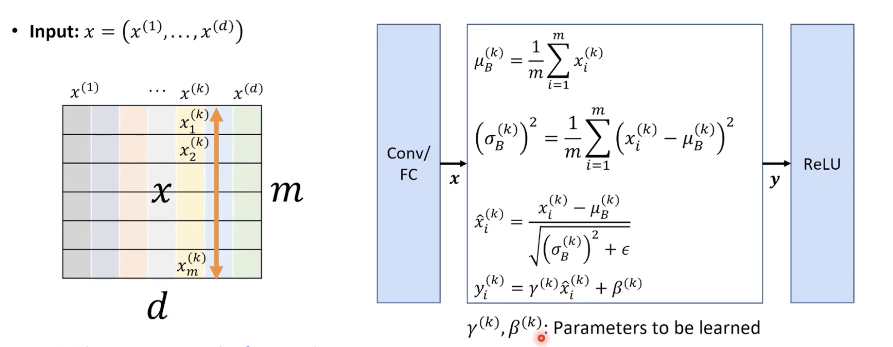
    对于 FC 层，作用于特征维度，对每个特征归一化

    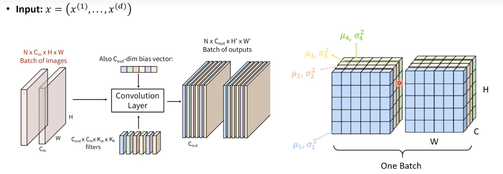
    对卷积层，对每个通道归一化（因为我们认为每个卷积层提取一个特征，形成一个通道，所以一个通道代表一个特征）
3. 推理阶段为了避免存储所有特征的值进行的改进：
   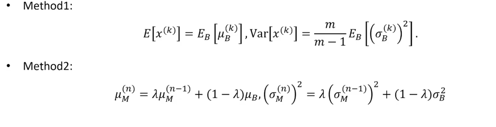

## Fine Grained Features
增加 passthrough layer，融合高低分辨率特征，detect 更小物体，提取更细粒度特征。

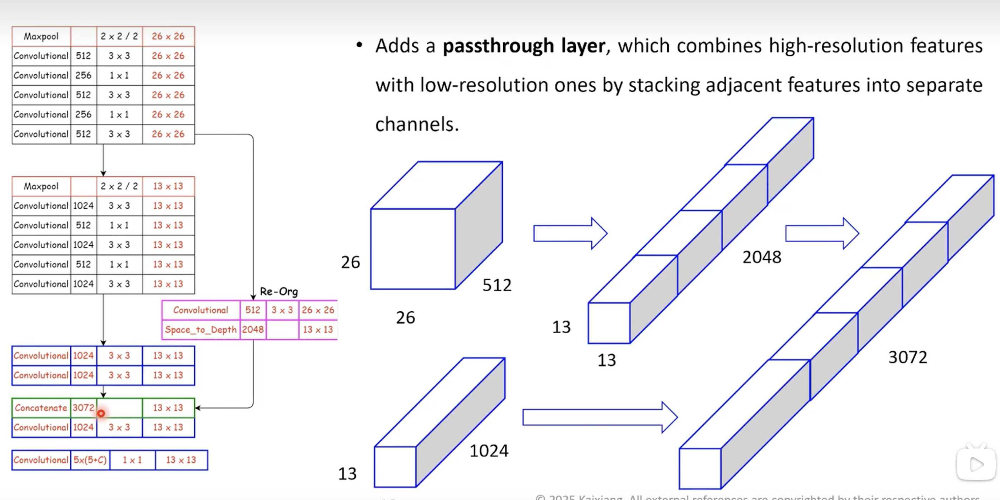

26x26转13x13类似下图，把几个元素拼成某一个通道
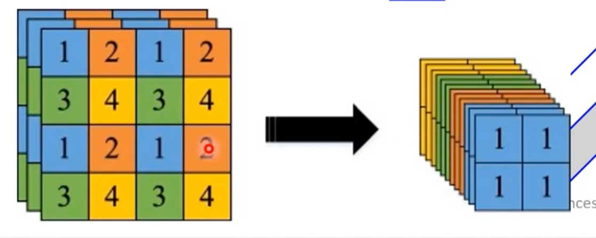

## High Resolution Classifier
提高目标检测性能。v1 在目标检测时输入分辨率改变，导致学习检测时需要调整权重。v2 预训练不变，增加448x448分辨率的微调，训练目标检测的效果提升。

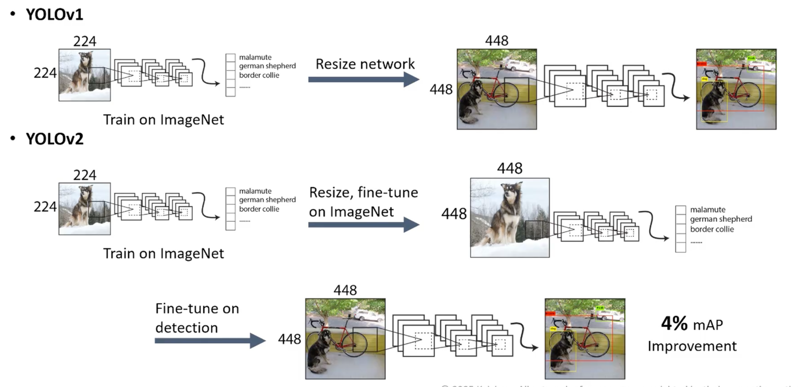
## Input Image Size Adjustment
调整输入图像尺寸为奇数，一般图像在中间，我们用图像中心点来检测，如果偶数方格会像右图一样难以判断中心点落在哪个 grid cell

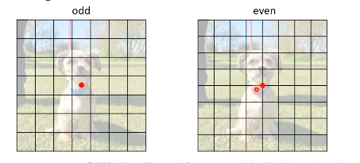

## Multi-Scale Training
每10个 batch 换一个分辨率，让模型能处理不同尺寸，且能防止过拟合（工程实现上需要调整标签）
> high resolution classifier **vs** multi-scale training
>  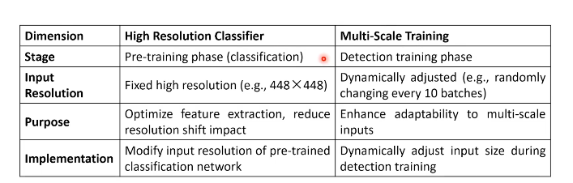

## Training

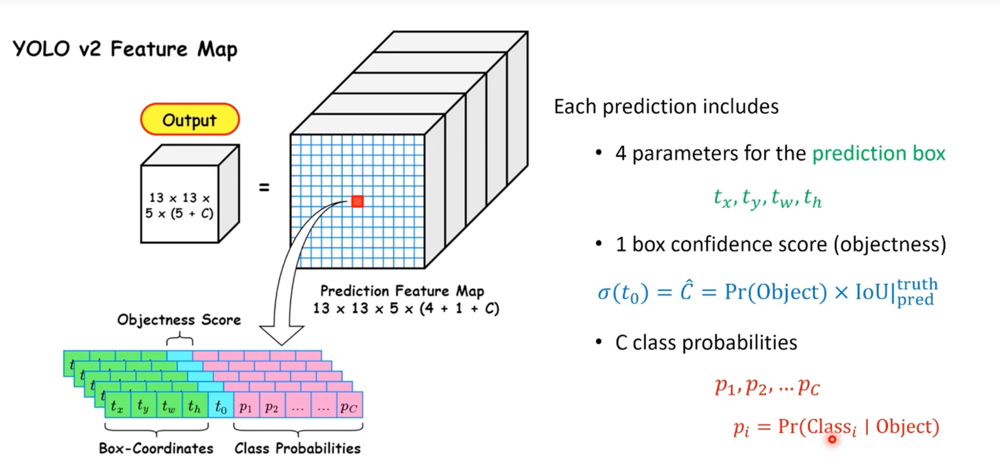

与 v1 的区别：
1. 每个 grid cell 预测 5 个 bounding box
2. 置信度外面套一个 sigmoid
3. 5 组 bounding box不共享 class-specific confidence score
4. xywh 代表与 anchor box 的偏移，并非直接随机生成
5. 如果多个物体中心点位于同一个 grid cell，保留两个预测框，分别是与 a/b 物体的 IoU 最大的两个

### Anchor Boxes
利用同种物体形状的共性，预先定义 box 的形状，再计算实际物体的偏移得到预测框。具体公式：

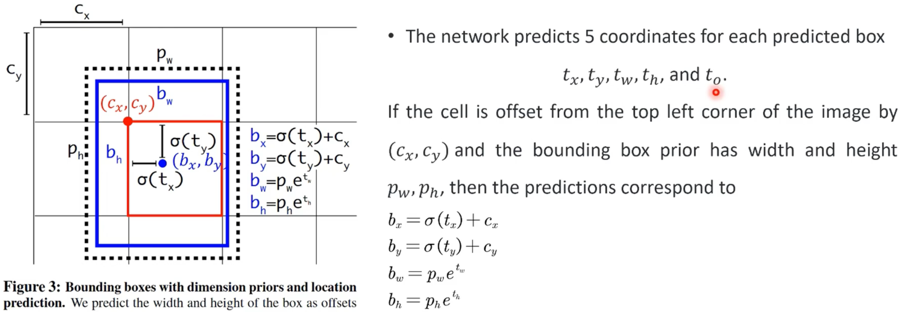

> anchor box 用于提高召回率（在所有真实存在的样本中，模型找出了多少），对准确率无益

### loss function
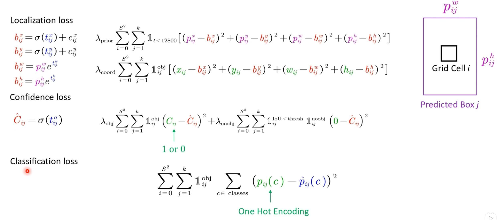

前 n 步先学习锚框（localization loss）

### Dimension Clusters
用能最好覆盖 training data 的 top-K 个 bounding box 做锚框，用 IoU 计算聚类。在选择聚类的个数时使用手肘法，从拐点取值

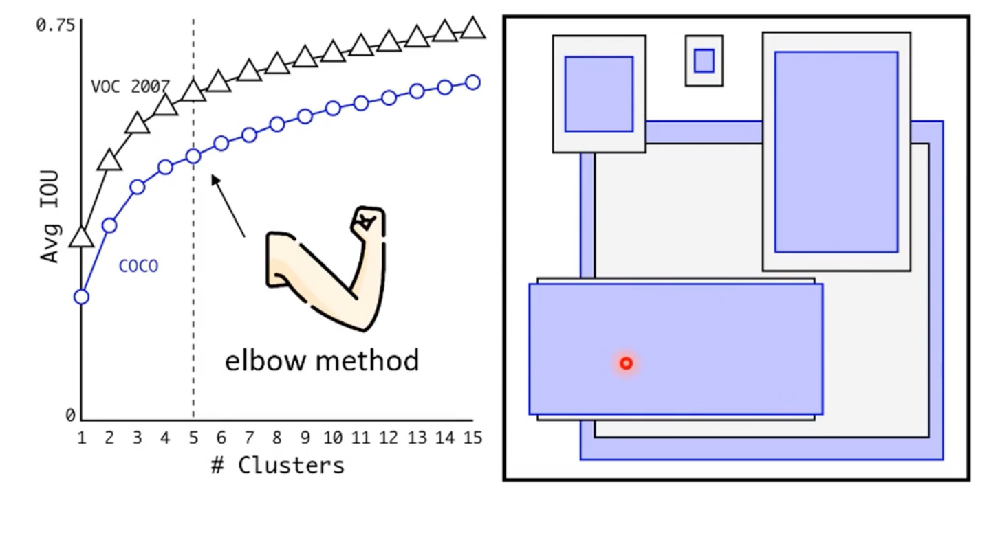

## 推理阶段
1. image grid division
2. bounding box predictions
3. NMS

# v3
> v1v2 只在最后一层做检测，语义信息强但分辨率低，不利于小物体识别
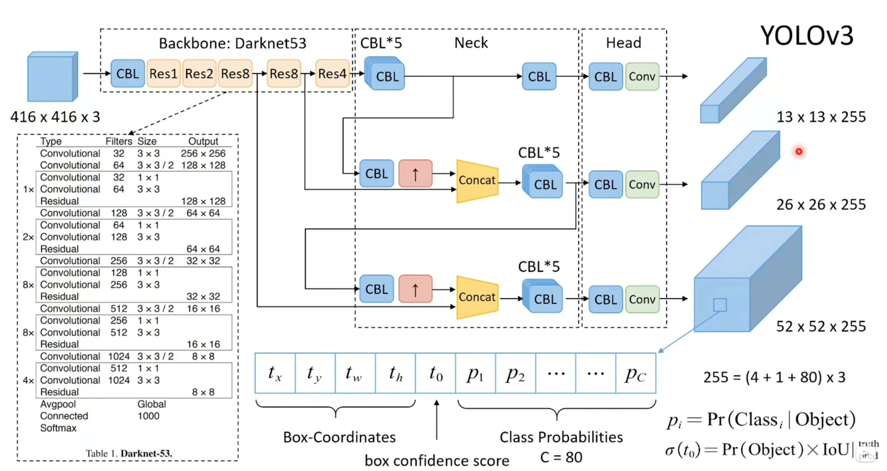

- backbone 是类似 resnet 的网络，且53层卷积
- 单元之间的卷积作用：尺寸减半通道翻倍，随网络加深可以强迫网络学高层特征
- 多尺度预测机制：不只最后一层参与检测，用前面层信息经过特征融合用于检测，大分辨率特征图有利于预测小物体
- 每个 cell 基于 anchor box 生成三个 bounding box

  
## training
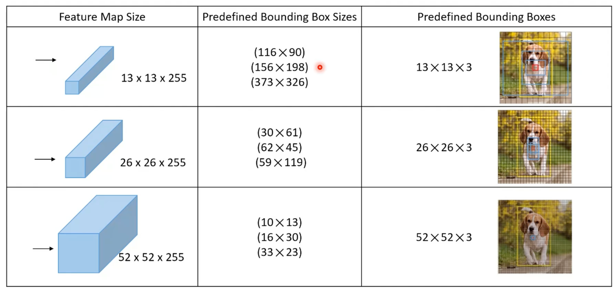

高分辨率定义的锚框小，用于识别小物体，低分辨率锚框大，识别大物体。

### loss function
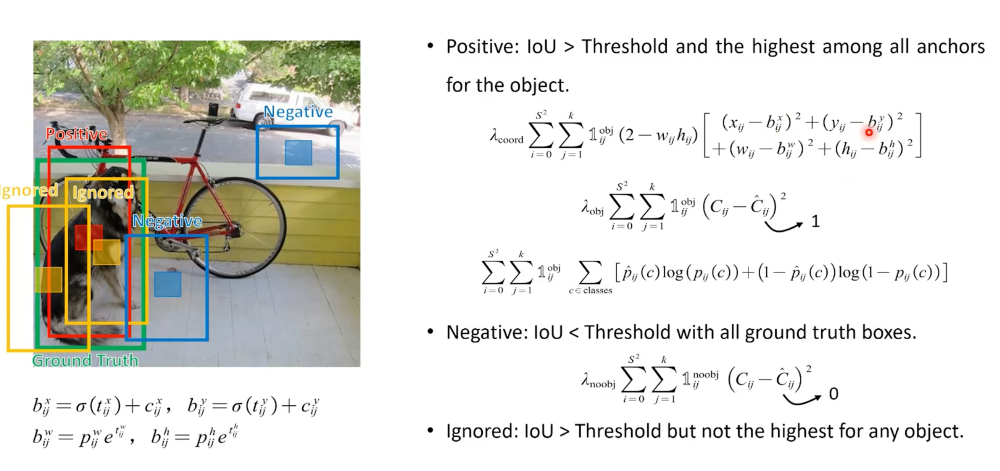
不同点：类别损失用交叉熵（**对齐 logits**），允许多个标签；不再使用 sigmoid（t0） 作为置信度

## 推理阶段
同v2

# v5

> **正样本**：训练阶段被分配去负责预测某个 GT 的网格点或候选框。正样本同时计算分类损失和坐标回归损失，决定模型能否检出目标并画准边界。
> **负样本**：训练阶段未被分配任何 GT 的背景网格点或候选框。负样本仅计算背景置信度/分类损失，用于抑制背景误检。
> **mAP**：综合衡量不同召回率下精确率的均值。`mAP@50` 指 IoU 大于 0.5 即算检出；`mAP@50-95` 指 IoU 从 0.5 到 0.95 步长 0.05 的平均值，对边界框定位精度要求极高。

v3到v5: 扩充正样本数量以提升召回率与训练收敛速度、削减主干网络冗余计算以提升推理速度（FPS）、强化特征融合与损失函数以提升边界框定位精度。

1. 增加正样本（提高召回率）
  -  计算 GT 与当前尺度 3 个 Anchor 的宽之比和长之比。只要宽高比在设定阈值（默认 $< 4.0$）以内，该 Anchor 即被纳入正样本候选（1 个网格内最多可匹配 3 个 Anchor）。
  -  除 GT 中心点所在的当前网格外，根据中心点偏离方向，选取距离中心点最近的 2 个相邻网格共同作为正样本网格。

2. Backbone 改进（提速）
  - `C3` 模块将输入特征图按通道对半切分为两个分支，分支一经过多个残差瓶颈层（Bottleneck），分支二不经过残差计算直接跨阶段与分支一的输出进行通道拼接
  - 在主干末端使用 3 个串联的 $5\times 5$ 最大池化层替代并联的大核池化，在数学结果完全等价的前提下减少计算耗时。

## loss function（提升精度）
* **v3 的局限**：单向 FPN 使深层大目标缺乏精准边缘信息；MSE 损失将坐标拆开独立优化，定位框不够紧凑。
* **v5 的改动**：
  1. FPN + PAN：在 FPN 自顶向下传递语义特征之后，增加一条自底向上的 PAN（路径聚合网络）支路，将浅层（8 倍下采样）的高分辨率边缘位置特征重新下采样传递回中层和深层特征图。
  2. **`CIoU Loss`（Complete IoU）**：将边界框回归损失由 MSE 替换为 CIoU，把预测框与真实框的**重叠面积、中心点欧氏距离、长宽比一致性**作为整体进行联合优化。

## 数据增强与工程规范（解决 v3 小目标泛化弱痛点）
* **v5 的改动**：训练时随机读取 4 张图像，经随机缩放、裁剪后拼接成 1 张图像输入网络（Mosaic 增强）；并通过 YAML 配置文件定义深度系数（控制模块重复次数）与宽度系数（控制通道数），标准化生成 `n / s / m / l / x` 五种体量的模型。
* **指标收益**：单次迭代包含更多复杂背景与缩小后的目标，显著**提升小目标召回率与工程部署灵活性**。

---

# v8

> 解决分类与回归共用卷积导致的特征冲突、消除预设 Anchor 对极端长宽比目标的泛化限制、以及解决静态样本分配导致的“分类高分但定位不准”假阳性问题 

## 解耦头 Decoupled Head
* **v5 的局限**：沿用耦合头，分类（Cls）和回归（BBox）共用同一组卷积核权重。但两项任务对特征的数学需求相反：
  * **分类任务需要“平移不变性”**：关注目标内部最显著的局部纹理，目标位置轻微偏移不应改变类别输出。
  * **回归任务需要“平移敏感性”**：关注目标四周的边缘轮廓，目标位置发生偏移时输出坐标必须同步改变。
  * 强行共用卷积会导致两个任务的梯度在训练时互相干扰。
* **v8 的改动**：
  1. **分支解耦**：特征图进入检测头后，立即拆分为两条完全独立的平行卷积分支（各自包含两个 $3\times 3$ 卷积和一个 $1\times 1$ 卷积），分别独立预测类别与边界框坐标。
  2. **移除 `Objectness` 分支**：删除预测目标存在概率的 `obj` 通道，直接用分类分支输出的最高类别概率作为目标置信度。

## Anchor-Free
* **v5 的局限**：
  1. **Anchor 依赖**：必须针对数据集预设 Anchor 尺寸，遇到长宽比极端（如细长缺陷、特殊视角目标）的数据集时，宽高比匹配失效，召回率下降；且每个网格预测 3 个框造成计算冗余。
  2. **标量回归局限**：直接预测单一坐标数值，在目标被遮挡或边界模糊时，单一数值无法表达边界的不确定性。
* **v8 的改动**：
  1. **Anchor-Free（无锚框）**：彻底废除预设 Anchor。每个网格点（Anchor Point）仅预测 1 个框，直接回归该网格中心点到目标真实框**左、上、右、下四条边的距离 $(l, t, r, b)$**。
  2. **引入 DFL（Distribution Focal Loss，分布焦点损失）**：不直接将每条边的距离回归为 1 个数字，而是将其建模为区间 $[0, \text{reg\_max}-1]$（默认 `reg_max=16`）上的离散概率分布（即每条边输出 16 个通道的概率值，4 条边共 $4 \times 16 = 64$ 个通道）。推理时通过 Softmax 激活后与 $[0, 1, \dots, 15]$ 加权求和（求数学期望），计算出精确的浮点距离。

## TAL 动态分配
* **v5 的局限**：采用静态匹配，只看 GT 与 Anchor 的几何宽高比和中心位置，完全不考虑网络当前对该框的实际预测质量。这会导致某些被分配为正样本的网格虽然分类得分很高，但预测出的边界框 IoU 很差（即“分类与定位不一致”），在推理时产生高置信度但框不准的假阳性（False Positive）结果。
* **v8 的改动**：引入 **TAL（Task-Aligned Assigner，任务对齐动态分配器）**。在每次训练迭代中，根据每个预测框当前的**分类得分 $s$** 和**预测框与 GT 的回归 IoU 值 $u$**，动态计算对齐度量指标：
  $$t = s^\alpha \cdot u^\beta$$
  （其中 $\alpha, \beta$ 为权重超参数）。对每个 GT，动态挑选出中心落在 GT 内部且 $t$ 值最高的前 Top-K（默认 $K=10$）个预测框作为正样本，其余全部作为负样本。

## Backbone 与 Neck 改进：`C2f` 模块
* **v5**：`C3` 模块中，主分支经过多个 Bottleneck 后仅将最后一个 Bottleneck 的输出拿去拼接，中间层的特征与梯度未能直接跨层保留。
* **v8**：将 `C3` 升级为 `C2f` 模块。在通道切分后，将每一个 Bottleneck 的中间输出全部保留，并一同汇入最终的通道拼接（Concat）层；同时删除了 Neck 上采样前的 $1\times 1$ 卷积降维层。

---

# v26

> 解决v8 工业部署（尤其是 CPU、移动端、嵌入式 NPU 芯片）问题：依赖 NMS 后处理导致端到端延迟高且在密集场景下易误删目标; DFL 模块中的 Softmax 与矩阵运算在边缘硬件上耗时高，且限制了超大目标的回归范围；三是 TAL 动态分配对微小目标不友好

## 双头协同与原生 NMS-Free
* **v8 的局限**：
  1. v8 采用 TAL 导致推理时每个目标周围会产生多个高分重叠框，必须在模型外部接 NMS 算法去重。
  2. 当两个真实目标距离近时，NMS 会将其中一个真实目标的高分预测框误判为冗余框直接删掉，导致召回率下降。
* **YOLO26 的改动**：
  1. 训练：两个检测头同时开启并共享主干与颈部。一对多头沿用 Top-10 分配，为主干网络提供充足的梯度信号；一对一头采用 Top-1 分配（每个 GT 仅分配 $t$ 值最高的唯一个正样本，其余相邻网格全部作为负样本抑制）。
  2. 推理：仅导出一对一检测头。由于一对一头在训练时已学会每个目标只激活唯一一个网格点输出，推理输出不再产生重叠冗余框，直接取前 Top-K 个最高分结果即为最终输出(取top-k是为了过滤背景)

## 移除 DFL
* **v8 的局限**：
  1. **硬件计算开销**：DFL 需要输出 64 维通道并执行 Softmax 激活与积分矩阵乘加，在低算力 CPU 和嵌入式芯片上占用大量内存带宽与计算周期。
  2. **超大目标回归受限**：v8 的 `reg_max=16` 意味着网格点到目标边界的最大预测距离被硬性限制在 $15 \times \text{步长}$（在最大尺度 32 倍下采样层上，单侧最大距离为 $15 \times 32 = 480$ 像素）。当图像分辨率较高或目标占满全图时，超出该范围的边界无法准确回归。
* **YOLO26 的改动**：恢复直接预测四边距离 $(l, t, r, b)$ 的连续标量回归结构。

## backbone
* **v8 的局限**：主干完全由局部卷积构成，感受野仅随层数线性缓慢扩大，缺乏对全局图像上下文的聚焦能力，易被背景噪声淹没。
* **YOLO26 的改动**：
  1. **`C3k2` 模块**：将 `C2f` 升级为 `C3k2`，内部使用两个串联的小卷积核替代单一较大卷积核，在维持相同感受野的前提下进一步压缩参数量与计算量。
  2. **`C2PSA` 模块（跨阶段局部空间注意力）**：在 Backbone 末端（SPPF 之后）引入轻量化的空间多头自注意力分支，仅对一半通道计算全局空间像素相关性后再拼接。

## `STAL`、`ProgLoss` 与 `MuSGD`
* **v8 的局限（微小目标正样本饥饿）**：在 v8 的 TAL 中，小目标训练初期预测框稍有偏差会导致 $u$（IoU）等于 0，进而导致对齐分数 $t=0$。小目标在动态分配中极难获得正样本，导致召回率低下。
* **YOLO26 的改动**：
  1. **`STAL`（Small-Target-Aware Label Assignment）**：在动态分配时检测 GT 面积，针对小于设定像素阈值的微小目标，自动放宽 IoU 匹配条件并结合中心距离度量，强制为每个微小目标保底分配足够数量的正样本。
  2. **`ProgLoss`（渐进式损失）**：在训练早期与晚期动态调整分类损失与回归损失的权重比例，避免训练初期不良回归梯度破坏特征提取。
  3. **`MuSGD` 混合优化器**：将传统 SGD 优化器与基于矩阵正交化的 Muon 优化算法融合，优化高维卷积权重的更新方向。

# quiz

## 输出张量维度演进推导
假设输入图像尺寸为 $640 \times 640$，数据集类别数 $\text{Cls} = 80$。Neck 输出的三个尺度特征图网格尺寸分别为 $80\times 80 = 6400$、$40\times 40 = 1600$、$20\times 20 = 400$，总计 **$6400 + 1600 + 400 = 8400$ 个网格点**，$B$ 为 Batch Size：

1. **YOLOv3 与 YOLOv5（Anchor-Based + 耦合头）**：
   * 每个网格点预设 3 个 Anchor，总候选框数为 $8400 \times 3 = 25200$。
   * 每个候选框预测 `4（坐标 x,y,w,h）+ 1（obj 置信度）+ 80（类别）= 85` 个值。
   * **输出张量维度**：`[B, 25200, 85]` -> 必须经过置信度过滤与 **NMS 后处理**才能得到最终结果。
2. **YOLOv8（Anchor-Free + 解耦头 + DFL）**：
   * 取消 Anchor，每个网格点仅预测 1 个框，总候选框数为 $8400$。
   * 删除 `obj` 通道；回归分支引入 DFL（`reg_max=16`），每个框输出 $4 \times 16 = 64$ 个回归通道 + $80$ 个类别通道 = $144$ 个通道。
   * **原始特征维度**：`[B, 144, 8400]` -> 经 DFL Softmax 积分求期望后变为 `[B, 84, 8400]`（$84 = 4 + 80$） -> 仍必须经过 **NMS 后处理**才能得到最终结果。
3. **YOLO26（Anchor-Free + 解耦双头 + 无 DFL + 原生无 NMS）**：
   * 推理时仅保留一对一检测头，总候选网格点为 $8400$。
   * 移除 DFL（`reg_max=1`），回归分支直接输出 4 个坐标通道 + 80 个类别通道 = 84 个通道。
   * **内部特征维度**：`[B, 84, 8400]` -> 在计算图内部直接通过 Top-K 算子选出最高分的 `max_det`（默认 300）个框，**端到端最终输出维度直接为 `[B, 300, 6]`**（其中 6 为解码好的 `[x1, y1, x2, y2, score, class_id]`），**无需任何外部 NMS 后处理**。

| 维度 | YOLOv3 (2018) | YOLOv5 (2020) | YOLOv8 (2023) | YOLO26 (2026) |
| :--- | :--- | :--- | :--- | :--- |
| **相对于上一代的核心动机** | 解决单尺度特征对小目标漏检问题 | **解决 v3 正样本极少导致的低召回率、慢收敛与高计算量** | **解决 v5 分类回归特征冲突、Anchor 泛化受限与静态分配误差** | **解决 v8 的 NMS 部署延迟、DFL 边缘计算开销与微小目标正样本饥饿** |
| **Backbone 核心模块** | Darknet-53（基础残差块） | CSPDarknet（`C3` 模块）+ SPPF | `C2f` 模块 + SPPF | `C3k2` 模块 + `C2PSA`（空间注意力） |
| **Neck 结构** | 单向 FPN（仅自顶向下） | 双向 FPN + PAN（`C3`） | 双向 FPN + PAN（`C2f`） | 双向 FPN + PAN（`C3k2`） |
| **Anchor 机制** | Anchor-Based（预设 9 个框） | Anchor-Based（自适应锚框） | Anchor-Free（预测中心至四边距离） | Anchor-Free |
| **Detection Head** | 耦合头（分类回归共用卷积） | 耦合头（含 `obj` 分支） | 解耦头（分类回归独立，移除 `obj`，引入 DFL） | 轻量化双头（一对一/一对多，移除 DFL） |
| **单尺度输出维度** | `3 * (4 + 1 + Cls)` | `3 * (4 + 1 + Cls)` | `4 * reg_max + Cls`（`reg_max=16`） | `4 + Cls`（`reg_max=1`） |
| **正负样本分配** | 单网格最大 IoU 静态匹配 | 跨网格宽高比静态匹配 | TAL 动态任务对齐分配 | 双头协同分配 + STAL（小目标感知分配） |
| **后处理 (NMS)** | 依赖 NMS | 依赖 NMS | 依赖 NMS | 原生 NMS-Free（端到端直接输出） |